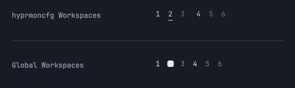

# Global Workspaces 0.1.1

Omarchy's classic workspace picker, with one set of numbers across every monitor. This is the first published release.

Install with `omarchy plugin install https://github.com/crmne/omarchy-global-workspaces`.

*Actual QML widgets rendered with synthetic workspace data in an isolated display.*

## New

- **Workspace 4 means workspace 4 on every screen.** Clicking a different number focuses that workspace, including on another monitor. The focused workspace is highlighted on every bar.
- **The original layout control is back.** Click the focused workspace's square, circle or triangle to cycle tiling, scrolling and floating layouts. Scroll to move through the displayed workspace destinations.
- **Your configured numbers remain visible.** The first five, configured empty workspaces and existing numbered workspaces are included. Workspace 10 is labelled `0`; higher numbers retain their IDs.

## Known limitations

This changes the bar, not ownership or shortcuts. For Omarchy 4.5, pair it with [hyprmoncfg 1.26.0](https://github.com/crmne/hyprmoncfg/releases/tag/v1.26.0) and an enabled global workspace plan. Omarchy's normal layout toggle still saves the focused workspace's layout. Named and special workspaces are not included.

## What's tested

All model tests and actual Qt widget interaction checks pass, covering number clicks, the focused layout action, scrolling, high IDs and vertical bars. Compositor commands were captured rather than executed during these checks.

## Thanks

Thanks to Omarchy's contributors for the original workspace widget and shared components. Their MIT attribution is retained.

**Full changelog**: https://github.com/crmne/omarchy-global-workspaces/commits/v0.1.1
